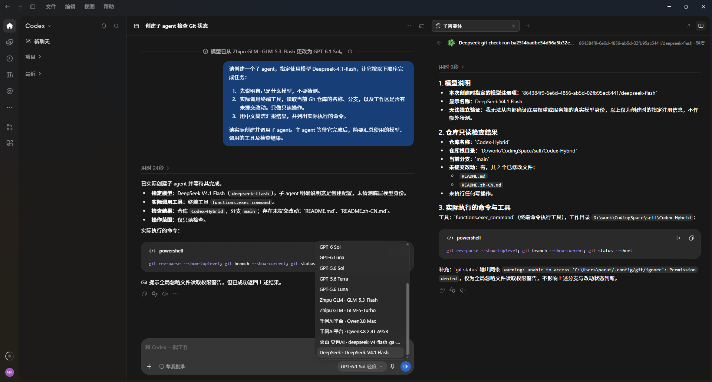

<div align="center">

# Codex Hybrid

**Switch freely between official and third-party models within a single Codex session.**

Switch models in your main chat, or let an official-model agent delegate to a third-party native subagent.<br>
Manage providers, models, and API keys locally, with optional CC Switch integration.

**English** · [简体中文](README.zh-CN.md)

[Quick start](#quick-start) · [See it in action](#see-it-in-action) · [Common commands](#common-commands) · [Documentation](docs/en/README.md)

</div>

## See it in action

<table>
  <tr>
    <td align="center" valign="top" width="33%">
      
    </td>
    <td align="center" valign="top" width="33%">
      
    </td>
    <td align="center" valign="top" width="33%">
      
    </td>
  </tr>
  <tr>
    <td align="center"><sub>Use third-party models as subagents</sub></td>
    <td align="center"><sub>Add providers and models manually</sub></td>
    <td align="center"><sub>Reuse CC Switch configuration</sub></td>
  </tr>
</table>

| What you want to do | How it works |
| --- | --- |
| Use a third-party model in Codex | Add a model → restart Codex → select it in the native model picker |
| Combine official and third-party models | Have an official-model agent create a native subagent with a specified model |
| Reuse existing configuration | Select CC Switch as a read-only source and continue editing in CC Switch |

## Quick start

### 1. Prerequisites

- **macOS or Windows** with **Python 3.11+** installed.
- The **Codex desktop app**, signed in, with at least one completed chat.
- A third-party provider's **API base URL, model ID, and API key**, or an existing **CC Switch** configuration.

### 2. Clone and launch

Clone the repository into a directory you plan to keep:

```sh
git clone git@github.com:MakiNaruto/Codex-Hybrid.git codex-hybrid
cd codex-hybrid
```

Run the command for your system from the project root:

| System | Terminal command |
| --- | --- |
| macOS | `sh scripts/codex-hybrid.sh install` |
| Windows (PowerShell) | `.\scripts\codex-hybrid.cmd install` |

The launcher creates `.venv`, installs dependencies, and opens the install wizard. **The wizard and management UI are currently in Chinese.** The first installation needs internet access to download dependencies.

### 3. Configure and restart Codex

1. Choose **Manual API setup**, **Local CC Switch**, or defer model setup to the web page and follow the prompts.
2. Choose whether to start the local service now. Installation does not enable client routing automatically.
3. After the service starts, enable **Client routing** in the management page, then **fully quit and reopen Codex**.

Turning the switch on backs up and updates Codex routing configuration. Turning it off restores the fields changed by this tool while preserving unrelated edits; the local service continues running. Switching also migrates local session routing metadata. Fully quit Codex and use an independent browser before confirming; see the [session migration guide](docs/en/session-migration.md).

The web UI includes setup readiness, unsaved draft warnings, provider/model filtering, activity status, error summaries and local sanitized diagnostics. See the [web trial checklist](docs/en/web-trial.md).

Private data is stored in `~/.codex-hybrid/` by default. Use the [local management page](http://127.0.0.1:18892/manage/) to add providers and models or update API keys. Management uses the forwarding port plus one by default (18892), or an explicit `management_port` in settings.json. Restart the service after upgrading and run `manage-url` for its current address.

> While routing is enabled, both official and third-party models depend on the local service. Run `start` after restarting your computer. See [advanced setup](docs/en/cli.md) for custom data directories, Codex paths, and YAML configuration.

### 4. Send your first message

Select a third-party model, start a new chat, and send:

```text
Reply only: Hello World
```

Expected reply: `Hello World`. This is a basic model check; see the [usage guide](docs/en/usage.md) for tool-call and native-subagent verification.

You can also click **Test connection** in the management page to send a basic request. Chats and connection tests use the selected provider's quota. Initial setup does not automatically call paid APIs.

## Common commands

The examples below use macOS. On Windows, replace `./scripts/codex-hybrid.sh` with `.\scripts\codex-hybrid.cmd`.

```sh
./scripts/codex-hybrid.sh start           # Start the service
./scripts/codex-hybrid.sh stop            # Stop the service
./scripts/codex-hybrid.sh status          # Show service status and model keys
./scripts/codex-hybrid.sh manage-url      # Get the management page URL
./scripts/codex-hybrid.sh refresh-models  # Update the model catalog, then restart Codex
./scripts/codex-hybrid.sh restart         # Restart the service after updating code
./scripts/codex-hybrid.sh rollback        # Restore the backup
./scripts/codex-hybrid.sh uninstall       # Stop service and confirm Codex configuration rollback
```

After adding or removing models, update the client model catalog and restart Codex. API key or base URL changes take effect on the next request.

## Learn more

| Guide | Topics |
| --- | --- |
| [Configuration](docs/en/configuration.md) | API keys, YAML, CC Switch, data directories, and migration |
| [Commands and advanced setup](docs/en/cli.md) | Commands, defaults, private access links, and custom paths |
| [Usage and verification](docs/en/usage.md) | Connection tests, main chats, native subagents, and verification limits |
| [Troubleshooting](docs/en/troubleshooting.md) | Missing models, 401 errors, installation, and rollback |
| [Architecture](docs/en/architecture.md) | Routing and credential boundaries |
