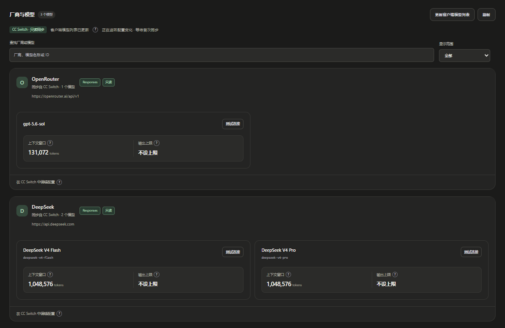

<div align="center">

# Codex Hybrid

[English](README.md) · **简体中文**

**让 Codex 在同一个会话中自由切换官方模型与第三方模型。**

主会话切换模型，也能让官方主 agent 调用第三方原生子 agent。<br>
通过本地管理页维护厂商、模型和 Key，支持复用 CC Switch 配置。

[快速开始](#快速开始) · [使用效果](#使用效果) · [常用命令](#常用命令) · [完整文档](docs/zh-CN/README.md)

</div>

## 使用效果

<table>
  <tr>
    <td align="center" valign="top" width="33%">
      
    </td>
    <td align="center" valign="top" width="33%">
      
    </td>
    <td align="center" valign="top" width="33%">
      
    </td>
  </tr>
  <tr>
    <td align="center"><sub>在 Codex 中使用第三方模型</sub></td>
    <td align="center"><sub>手动添加厂商与模型</sub></td>
    <td align="center"><sub>复用 CC Switch 配置</sub></td>
  </tr>
</table>

| 你想做什么 | 如何使用 |
| --- | --- |
| 在 Codex 中使用第三方模型 | 添加模型 → 重启 Codex → 在原生模型列表中选择 |
| 官方模型与第三方模型协作 | 官方主 agent 创建指定模型的原生子 agent |
| 复用已有配置 | 选择 CC Switch 来源，只读同步，继续在 CC Switch 中维护 |

## 快速开始

### 1. 准备环境

- **macOS / Windows**，安装 **Python 3.11+**。
- 安装并登录 **Codex 桌面客户端**，完成过一次聊天。
- 准备第三方模型的 **API 地址、模型 ID、Key**，或已有的 **CC Switch** 配置。

### 2. 下载并启动

使用 Git 将仓库克隆到准备长期保留的目录：

```sh
git clone git@github.com:MakiNaruto/Codex-Hybrid.git codex-hybrid
cd codex-hybrid
```

在项目根目录运行对应命令：

| 系统 | 终端命令 |
| --- | --- |
| macOS | `sh scripts/codex-hybrid.sh install` |
| Windows（PowerShell） | `.\scripts\codex-hybrid.cmd install` |

启动器自动创建 `.venv`、安装依赖并打开中文向导。首次安装需要联网下载依赖。

### 3. 按向导配置，重启 Codex

1. 选择 **手动填写 API**、**本机 CC Switch**，或选择 **稍后在网页配置** 先进入空管理页。
2. 按提示选择是否现在启动本机服务；安装不会自动启用客户端路由。
3. 服务启动后，在管理页点击“客户端路由”开关启用路由，然后**完全退出并重新打开 Codex**。

打开开关时，程序会备份并更新 Codex 接入配置；关闭时恢复接入前被修改的字段，同时保留无关修改，本地服务保持运行。切换只迁移本机会话索引：开启时保留模型，关闭时仅将第三方模型替换为官方列表首个可用模型；历史文件和配置默认模型保持不变。请先完全退出 Codex，并在独立浏览器操作。详见[会话迁移说明](docs/zh-CN/session-migration.md)。

管理页支持使用准备概览、未保存草稿提醒、厂商与模型筛选、活动状态、错误摘要和本地脱敏诊断下载，试用步骤见[网页版试用清单](docs/zh-CN/web-trial.md)。

默认数据保存在 `~/.codex-hybrid/`，后续可在[本地管理页](http://127.0.0.1:18892/manage/)添加厂商、模型或修改 Key。管理端口默认是转发端口加 1（默认 18892），可在 settings.json 设置独立的 `management_port`。升级后重启服务，再用 `manage-url` 获取当前地址。

> 启用路由后，官方与第三方模型都依赖本地服务；重启电脑后请先运行 `start`。自定义数据目录、Codex 路径及手动 YAML 配置见[安装进阶](docs/zh-CN/cli.md)。

### 4. 发出第一条消息

选择第三方模型，新建聊天并发送：

```text
只回复：Hello World
```

预期收到 `Hello World`。这能初步确认模型可用；工具调用与原生子 agent 的验证步骤见[使用指南](docs/zh-CN/usage.md)。

管理页也可点击 **测试连接** 发送一次基础请求。聊天和连接测试都会使用相应供应商额度；首次配置不会自动调用付费 API。

## 常用命令

以下以 macOS 为例；Windows 将 `./scripts/codex-hybrid.sh` 换成 `.\scripts\codex-hybrid.cmd`。

```sh
./scripts/codex-hybrid.sh start           # 启动服务
./scripts/codex-hybrid.sh stop            # 停止服务
./scripts/codex-hybrid.sh status          # 查看服务状态与模型 key
./scripts/codex-hybrid.sh manage-url      # 获取管理页面地址
./scripts/codex-hybrid.sh refresh-models  # 更新客户端模型列表，随后重启 Codex
./scripts/codex-hybrid.sh restart         # 更新代码后重启服务
./scripts/codex-hybrid.sh rollback        # 恢复接入前备份
./scripts/codex-hybrid.sh uninstall       # 停止服务并交互确认恢复 Codex 配置
```

新增或删除模型后，更新客户端模型列表并重启 Codex；仅修改 Key 或 API 地址时，下一轮请求生效。

## 继续探索

| 文档 | 内容 |
| --- | --- |
| [配置指南](docs/zh-CN/configuration.md) | API Key、YAML、CC Switch、数据目录与迁移 |
| [命令与安装进阶](docs/zh-CN/cli.md) | 全部常用命令、默认值、私密链接、自定义路径 |
| [使用与验证](docs/zh-CN/usage.md) | 连接测试、主会话、原生子 agent 示例与验证边界 |
| [常见问题](docs/zh-CN/troubleshooting.md) | 模型未出现、401、安装失败、回滚 |
| [工作原理](docs/zh-CN/architecture.md) | 请求路由与凭据边界 |
