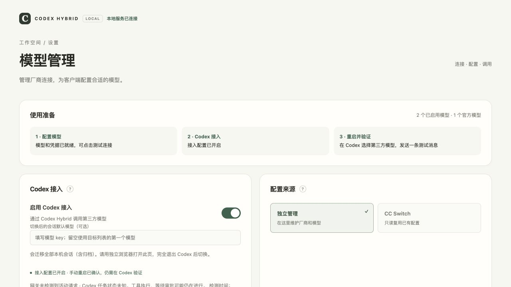

# 网页版试用清单

本轮继续迭代现有管理页，暂不做桌面打包、托盘和自动重启，也不增加冲突修复流程。

## 打开新版

在项目目录重启本地服务，随后刷新独立浏览器里的管理页：

```sh
./scripts/codex-hybrid.sh restart
./scripts/codex-hybrid.sh manage-url
```

Windows 对应使用 `.\scripts\codex-hybrid.cmd`。自定义数据目录时请沿用原来的 `--data-dir`。已有管理页链接继续使用；私密链接从 `manage-url` 获取。不要用测试环境的 18991 端口作为真实实例地址。

服务重启会中断尚未完成的网关请求，请等当前任务结束后操作。本轮开发未停止你的真实服务，也未改动真实 Codex 配置或发送付费请求。

## 建议试用顺序

1. 看顶部“使用准备”和本地服务连接状态。凭据可读取与连接成功分别显示，不会自动测试厂商。
2. 搜索厂商或模型名称、ID，切换“已启用 / 含未启用模型”筛选。
3. 修改一个厂商但不保存，应出现“未保存”标记。编辑并保存另一个厂商，第一个草稿应保留。草稿不写入浏览器存储，关闭前应保存。
4. 检查高级参数中的请求超时、上下文与输出上限校验；新厂商使用重复标识时页面会拦截。
5. 保存后点击“测试连接”。这会发出一次真实请求、使用厂商额度，成功后显示模型 ID 和耗时。测试的是已保存配置。复制模型 key 后可在 Codex 中使用。
6. 接入或目录变化后，顶部会提示手动重启；确认记录会在页面刷新和服务重启后保留。Key/API 地址更新不改变目录时不重复要求重启。
7. 接入切换现在涉及本机会话线路元数据，请先完全退出 Codex，并在独立浏览器确认。范围、备份和恢复见[会话迁移](session-migration.md)。
8. 查看底部“运行与诊断”，展开最近错误摘要，下载脱敏 JSON。诊断不会自动上传，也不包含配置、Key 或对话。

## 本轮实现

- 安装向导增加“稍后在网页配置”，无第三方模型时也可启动管理页。
- 使用准备概览、凭据可读取状态、搜索与启用状态筛选。
- 未保存标记、离开/刷新/切换来源提醒，保存其他厂商保留草稿。
- 模型 key 复制、测试耗时、厂商请求超时编辑、输入校验和更明确的错误反馈。
- 手动重启确认独立持久保存，不把用户确认当作实际加载验证。
- 网关活动计数、最近错误摘要、白名单诊断下载。
- 运行及错误日志各按 2 MiB 轮转、各保留 3 份旧文件；异常大的元数据记录压缩为摘要。

## 验证与边界

最终回归：64 项测试通过，JavaScript 语法与 Git 差异检查通过。

自动化覆盖空配置初始化、跳过凭据的安装向导、来源切换保留独立数据、CC Switch 数据库不写入、重启确认持久化与过期确认拒绝、Key 更新、日志轮转、诊断脱敏、请求及流式活动释放。没有用真实厂商进行付费验证。

隔离浏览器环境已实际检查：两个厂商草稿保留与保存、搜索空结果、模拟上游测试成功与耗时、接入预览确认、页面刷新后重启提醒保留、手动确认提醒更新、诊断下载，以及桌面宽度和 390px 宽度布局。示例使用临时目录与虚拟凭据；截图不代表真实模型配置。

最后的未保存刷新确认测试被浏览器自动化弹窗阻塞，取消后草稿保留、确认放弃、浏览器离开提醒仍请人工检查。完整真实 Codex 对话、工具调用、真实会话迁移和 Windows 实机仍需人工验收。没有网关请求不代表任务空闲；网页不会自动退出、启动或重启 Codex。

诊断只读取当前日志末尾 128 KiB 内最近 20 条错误，不搜索旧轮转文件。历史版本留下的超大日志可能在首次轮转后成为旧文件；新日志策略要重启服务后生效。启动早期错误见 `service.startup.stderr`，该文件每次后台启动重新创建。


